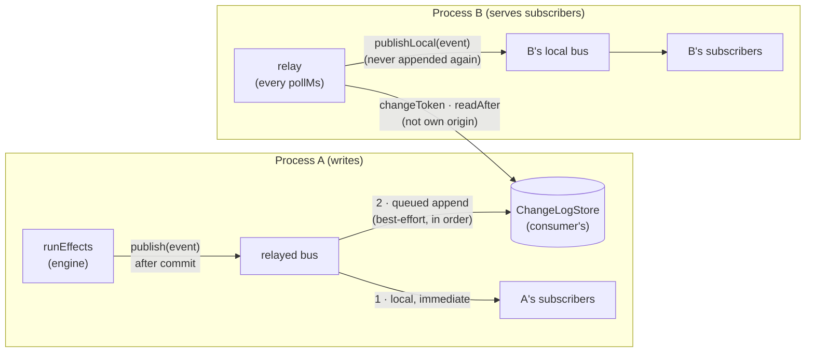
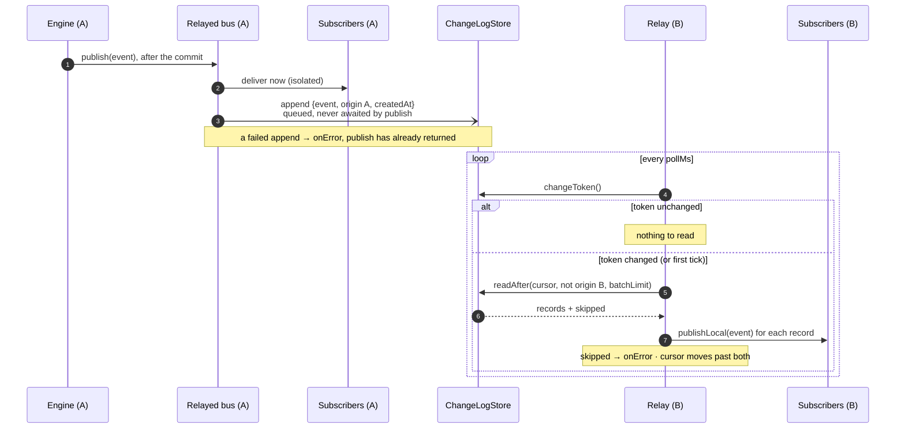
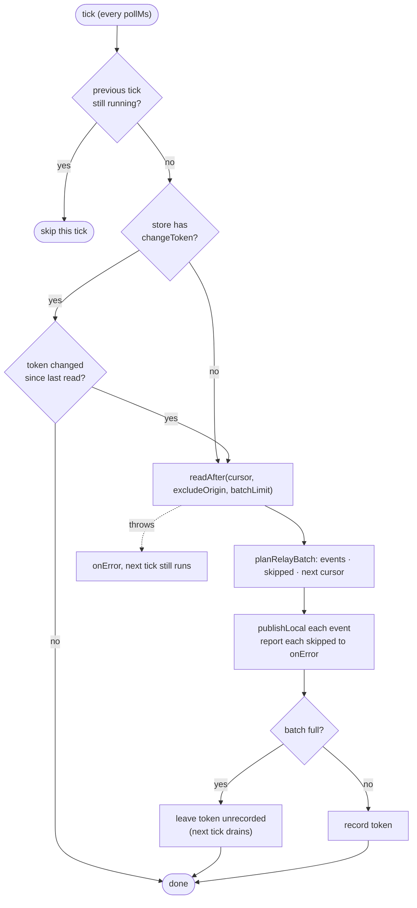

# ADR 0003: A store-backed change bus for deployments that span processes

- **Status:** Accepted
- **Date:** 2026-11-14
- **Revises:** ADR 0002 §3 (multi-process transports were left entirely to the consumer)

## Context

`createChangeBus` is process-local (ADR 0002 §2–§3). A consumer whose writers run in several processes over one
shared store needs the notifications to cross processes. ADR 0002 left that transport to the consumer.

The first consumer to need it wrote it, and most of what it wrote was not about its store at all:

- a bus that publishes locally first and then records the event, in order, as a best-effort write that never fails
  or delays `publish`;
- a relay that starts at the newest record (no replay), reads the other processes' records past a cursor, publishes
  them locally only (no echo back into the store), drains a backlog in bounded batches, never overlaps itself,
  survives a failing tick, and prunes old records;
- the pure decisions behind it: the next cursor over a batch, which records to report as undecodable, the prune
  cutoff.

Only the storage was specific: a table, its queries, and a cheap "did anyone else commit?" signal. Every consumer
that spans processes would write the same mechanics again, with the same subtle cases (ordering, echo, replay,
undecodable records, isolation of a failing reporter). Those cases are exactly what this package already owns for
the in-process bus.

## Decision

1. **The package provides the mechanics; the consumer provides the store.** A port, generic over the event:

   ```ts
   type ChangeLogRecord<E> = { id: number; origin: string; event: E };
   type ChangeLogEntry<E> = ChangeLogRecord<E> | { id: number; skipped: string };

   type ChangeLogStore<E> = {
     append: (record: { event: E; origin: string; createdAt: string }) => Promise<void>;
     latestId: () => Promise<number>;
     readAfter: (afterId: number, excludeOrigin: string, limit: number) => Promise<readonly ChangeLogEntry<E>[]>;
     pruneBefore: (isoInstant: string) => Promise<void>;
     /** Optional hint: any value that changes when another process may have written. Absent: always read. */
     changeToken?: () => Promise<unknown>;
   };
   ```

   `id` is increasing in write order. A record the store cannot decode is returned as `skipped` with its id and the
   reason, never thrown, so one bad record cannot block the ones after it. The store owns its connections and their
   lifetime; the package never opens or closes anything.

2. **`createRelayedChangeBus<E>`** returns `{ bus, publishLocal, settled }`:
   - `bus` is a `ChangeBus<E>`. `publish` delivers to local subscribers first, through the same isolated in-process
     bus as `createChangeBus`, then queues an append. Appends run one at a time in `publish` order and are never
     awaited by `publish`. A failed append goes to `onError`; a throwing `onError` is dropped. An optional
     `shouldAppend(event)` skips events not worth recording.
   - `publishLocal` publishes on the local bus only. It is what a relay uses, so a relayed event is never recorded
     again.
   - `settled()` resolves once every append requested so far has finished or failed (for shutdown and tests).

3. **`startChangeRelay<E>`** takes the store, `publishLocal`, the process's `origin`, `pollMs`, `retentionMs`,
   `pruneEveryMs`, `batchLimit`, an optional `clock` and `onError`, and resolves to `{ stop }` once its cursor is in
   place, so any write made after it resolves is seen.
   - The cursor starts at `latestId()`: no replay.
   - Each tick reads `changeToken()` when the store provides it and reads records only when the token changed (the
     first tick always reads). It reads past the cursor, excluding its own origin, at most `batchLimit`, in id order,
     publishes each decoded event with `publishLocal`, reports each skipped record to `onError`, and moves the cursor
     past both. A full batch leaves the token unrecorded, so the next tick drains the rest.
   - Ticks and prunes never overlap themselves. A failing one is reported and the next still runs.
   - Every `pruneEveryMs` it deletes records older than `retentionMs`.
   - `stop()` clears the timers and waits for the tick or prune in flight.

4. **The decisions are pure and exported**: the next cursor and the split into events and skipped records for a
   batch, the prune cutoff, whether a token means "read". They are tested without timers or a store.

5. **The package stays driver-free and runtime-agnostic.** It only calls the port; it imports no driver, and it uses
   only the timers every JavaScript runtime has. It calls `unref` on a timer only when the runtime provides it, so
   the relay never keeps a process alive.

6. **Additive.** `createChangeBus`, `ChangeBus`, `PublishChange` and the engine are unchanged. The engine still sees
   only a `ChangeBus`; whether it relays is invisible to it. This is semver-minor.

ADR 0002 §3 now reads: a deployment spanning processes either uses `createRelayedChangeBus` with its own
`ChangeLogStore`, or implements `ChangeBus` over another transport; the engine does not change either way.

## How it fits together

What the package provides (inside each process) and what the consumer provides (the store). Two processes share one
store; each has its own local bus and subscribers.



A write in A reaching a subscriber in B:



One relay tick, in detail:



Pruning runs on its own timer, never overlapping itself: every `pruneEveryMs`, `pruneBefore(now − retentionMs)`.

## Consequences

- A consumer that spans processes writes only its store: a table (or equivalent), its queries, its decoding, and
  optionally a cheap change token.
- Delivery across processes is at-most-once and best-effort, like the local bus. A lost append or a pruned record
  costs one missed notification; consumers that need more resync on their side.
- Latency across processes is about one `pollMs`. Same-process delivery stays immediate.
- The package now owns timers and a polling loop, only for consumers that opt in. `createChangeBus` alone is
  unaffected.
- The store port is shaped by one consumer so far. It is kept small; a second consumer may widen it, additively.
