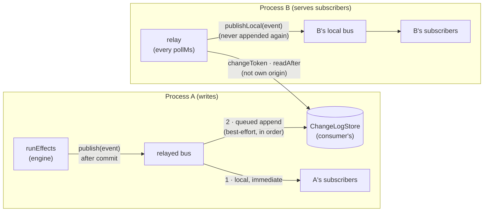
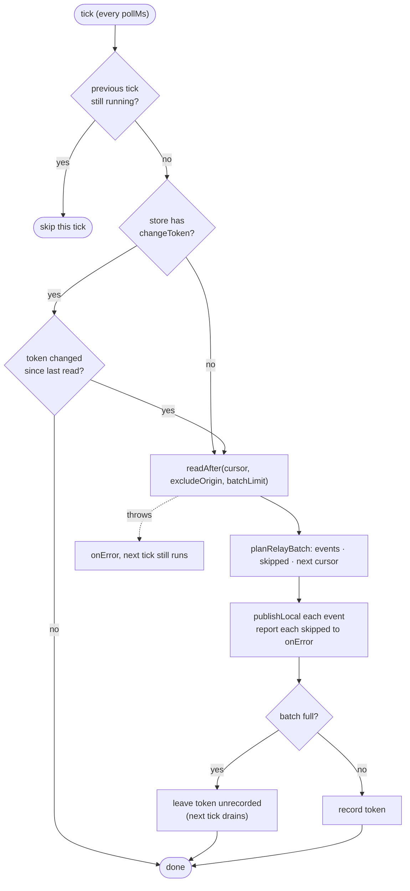

# Architecture

How `@rfc0/effect-runner` is built. The conceptual foundation is
[Functional Core, Imperative Shell](functional-core-imperative-shell.md); this document is the engine's as-built
design. The source of truth is [`src/persistable.ts`](../src/persistable.ts) (data contract) and
[`src/engine.ts`](../src/engine.ts) (shell + adapter port).

## The split the engine implements

- **The domain (functional core)** decides. Its flow is a thunk the shell invokes, yielding a neverthrow
  `ResultAsync<FlowOutcome<T>, E>`: domain failures stay on the error track, and on the Ok path `FlowOutcome<T>`
  carries a batch of `Persistable`s describing the writes plus the response the caller gets. It performs no writes.
- **The shell (`runEffects`)** executes. It applies the batch through an adapter you supply, owns atomicity,
  concurrency, idempotency and retry, and returns the response.

The engine is generic over an opaque transaction handle `TTx` and the consumer's error type `E`. It imports only
`zod`, `neverthrow` and `remeda`, and never a database driver (lint-enforced; see
[ADR 0001](adr/0001-extracted-from-an-application.md)). `zod` is a peer on either major (3.25+ or 4.6.6+), so `src/` uses only
API common to both, and CI runs typecheck and tests against each.

## The data contract

| Export | Role |
|---|---|
| `Persistable<Tag, Model>` | An effect intent, one of four shapes (below). |
| `checkVersion(entity, id, version)` | Builds the `check` shape. |
| `PersistOp` | Zod enum `insert \| update \| delete \| check`; construct ops via `PersistOp.enum.*`, never bare strings. |
| `PersistOutcome` | `{ entity, applied, read? }` — what happened when one `Persistable` was applied. |
| `FlowOutcome<T>` | `{ persist: Persistable[]; response: T \| ((outcomes: PersistOutcome[]) => T) }`. |
| `PersistenceMeta` / `withPersistenceMeta(schema)` | The optimistic-concurrency `version` token (a non-negative int), added to an entity schema without polluting the pure model. |
| `INITIAL_VERSION` | `0` — where a fresh row starts. |

The four `Persistable` shapes:

- `insert` — `{ op, entity, model, idempotencyKey? }`. The model carries no `version`; a new row always starts at
  `INITIAL_VERSION`, which the core does not decide. `idempotencyKey` is optional dedup metadata for the intent,
  not a model field.
- `update` — `{ op, entity, model }` where `model.version` is the version the core **read**. The applier
  computes the persisted version as `model.version + 1`.
- `delete` — `{ op, entity, id, version }`: the id plus the version read, for the same guard.
- `check` — `{ op, entity, id, version }`: asserts the row is still at the version read and writes nothing (see
  [Read-set validation](#read-set-validation)).

`entity` is a consumer-owned tag; the shared type never enumerates entities.

### Responses

`response` is normally a plain value the core already holds. For an idempotency-aware flow whose response depends
on whether a write really happened (e.g. a `created` flag), `response` is instead a **synchronous, pure** function
of the `PersistOutcome[]`, called once the batch has committed. A flow that needs a further write puts it in
`persist`; `response` never performs I/O. Outcomes are matched by `entity` tag, not position.

## The adapter port

What an integrator implements:

- **`TransactionRunner<TTx>`** — `runInTransaction(work: (tx: TTx) => Promise<T>): Promise<T>`. Opens a unit of
  work, commits on success, rolls back when `work` throws.
- **`EntityApplier<TTx>`** — per entity, `insert(tx, model, idempotencyKey?)`, `update(tx, model)`,
  `delete(tx, id, version)`, each returning `{ applied, read? }`, plus an optional read-only
  `check(tx, id, version)` (required only for entities a flow checks). Appliers do the mechanical write over `tx`
  and decide nothing; they do not state their own entity tag (the engine stamps it from the `Persistable`).
- **`ApplierRegistry<TTx>`** — `Record<string, EntityApplier<TTx>>`, keyed by entity tag. Adding an entity is
  registration, never a new branch in the engine. An unregistered tag throws.
- **`ReadBack<TTx>`** — `(tx, id) => Promise<unknown>`: an optional per-entity post-write projection an applier
  may use to populate `PersistOutcome.read`, run inside the transaction against the row that actually persisted
  (on an idempotent duplicate, the surviving row). It is the one sanctioned read inside the engine's unit of
  work.
- **`IsTransientContention`** — `(cause: unknown) => boolean`: classifies a driver error as retryable physical
  contention (e.g. a busy lock) as opposed to a genuine failure.
- **`EngineContext<TTx, E>`** — `{ runner, isTransientContention, conflictError, onPublishError? }`. `conflictError: () => E` is
  the injected factory that maps retry exhaustion into the consumer's own error type, so the engine owns no
  error taxonomy.
- **`PublishChange`** — optional post-commit hook `(entities: readonly string[]) => void`, defaulting to a
  no-op (see [Change notification](#change-notification)).
- **`ChangeBus<E = readonly string[]>`** — `{ publish(event: E); subscribe(listener) => unsubscribe }`, the transport
  behind `PublishChange`; the package ships an in-memory `createChangeBus<E>`. The default `E` is the entity-tag
  list, so the `publish` member of a parameterless `ChangeBus` is assignable to `PublishChange`.

## Semantics

**One transaction per batch.** `runEffects(ctx, registry, flow, publish?)` runs `flow()`, then applies its whole
`persist` batch inside a single `runInTransaction`, dispatching each `Persistable` to its entity's applier in
order. All-or-nothing. An empty batch (e.g. a dry-run preview) skips the transaction entirely.

**Optimistic-concurrency guard.** For `update` and `delete`, the applier conditions the write on the version the
core read (`UPDATE … SET …, version = version + 1 WHERE id = ? AND version = ?`). If it matches no row it
reports `applied: false`, and the engine raises `VersionConflict`, which rolls back the batch.

**Retry.** A thrown cause is retryable if it is a `VersionConflict` or `isTransientContention(cause)` is true;
anything else propagates as a genuine error. A retryable failure rolls back the whole batch and **re-invokes the
flow** — fresh reads, fresh decision — up to `MAX_RUN_EFFECTS_ATTEMPTS` (3) attempts in total. Exhaustion
surfaces `ctx.conflictError()` on the error track. `VersionConflict` is exported so an applier can raise the
same retry for its own non-version conflict (e.g. a unique/FK race).

**Idempotency.** An `insert` may carry `idempotencyKey`. The applier writes it to a fixed key column and, on a
duplicate key, skips the write and returns `applied: false` with `read` reflecting the existing row. Inserts are
never retried for being duplicates; the flow's response function can observe `applied: false` and report
`created: false`.

**Independent units.** `runEffectsSequence(ctx, registry, items, flowFor, publish?)` applies items in order, each
through its own transaction and its own bounded retry — identical semantics to `runEffects` by construction.
`flowFor(item)` is invoked only once earlier items have committed or failed, so unit *i+1* sees unit *i*'s
writes. A unit's domain error or retry exhaustion is recorded as an `Err` and the loop continues (partial
success); only an unexpected failure throws. It returns a neverthrow `Result<T, E>` per item.

## Read-set validation

A `check` guards a row the decision *read* but does not *write*. Optimistic concurrency on writes alone cannot see
that: if a decision depends on row A (a balance, a parent's status) but only writes row B, a concurrent change to A
commits cleanly and the decision is stale (write skew). A `check` closes that gap by validating the read set inside
the same transaction as the writes.

The guarantee holds only if the applier's `check` keeps the row from changing until commit. A plain version `SELECT`
does not: under READ COMMITTED or snapshot isolation two transactions can check each other's rows, update different
rows, and both commit. The applier must therefore either lock the row (e.g. `SELECT … FOR SHARE`/`FOR UPDATE`, so
a concurrent writer blocks) or run under serializable isolation, with serialization failures classified as
retryable by `isTransientContention`. On a single-writer store (e.g. SQLite) the transaction already serializes.

The engine calls the entity's `check(tx, id, version)` in batch order. `applied: false` raises `VersionConflict`,
so the batch rolls back and the flow re-runs through the normal bounded retry (`MAX_RUN_EFFECTS_ATTEMPTS`, then
`ctx.conflictError()`). A check writes nothing, yields no `PersistOutcome`, and its entity never appears in the
published change set. A `check` for an entity whose applier lacks `check` throws a plain `Error` (a programming
error, not retried).

Use it instead of rewriting the row (`update` with an unchanged model) when the row was only read: that bumps its
version, needlessly conflicts with other readers, and publishes a change that did not happen.

```ts
persist: [checkVersion('account', account.id, account.version), { op: PersistOp.enum.insert, entity: 'entry', model: entry }]
```

## Change notification

`PublishChange` fires once per committed batch, with the deduped entity tags of the outcomes that wrote
(`applied: true`). Idempotent duplicates publish nothing, so an all-duplicate or empty batch publishes nothing,
and it never fires for a rolled-back or retried attempt — only after the commit that stuck.

Notification is best-effort and never part of the write: if `publish` throws or returns a rejecting promise
(an async transport), the failure is routed to
`ctx.onPublishError` (when set) and `runEffects`/`runEffectsSequence` still return the committed response.

The package ships the `ChangeBus` interface and `createChangeBus`, an in-memory implementation (a `Set` of
listeners; a throwing listener is isolated and reported to its `onError` option; listeners are snapshotted per
publish) as the default transport. It is process-local: a multi-process deployment implements the same
`ChangeBus` interface over its own transport (e.g. a database `LISTEN`/`NOTIFY` or a message broker) and passes
its `publish` to the engine unchanged.

```ts
const bus = createChangeBus({ onError: reportListenerFailure });
const unsubscribe = bus.subscribe((entities) => invalidateCaches(entities));
await runEffects({ ...ctx, onPublishError: reportPublishFailure }, registry, flow, bus.publish);
```

The bus is generic over its event. `runEffects` always calls `publish` with entity tags, so a consumer that wants a
richer event adapts at its composition root and the engine stays unchanged; isolation and `onError` behave
identically for any `E`.

```ts
type CommitEvent = { entities: readonly string[]; at: Date };

const bus = createChangeBus<CommitEvent>({ onError: reportListenerFailure });
const publish: PublishChange = (entities) => bus.publish({ entities, at: new Date() });
await runEffects({ ...ctx, onPublishError: reportPublishFailure }, registry, flow, publish);
```

## Across processes

`createChangeBus` is process-local. For writers in several processes over one store, the package supplies the
mechanics and the consumer supplies a `ChangeLogStore<E>` (see [ADR 0003](adr/0003-relayed-change-bus.md)): `append`,
`latestId`, `readAfter` (entries past a cursor, excluding an origin, in id order; an undecodable record is returned as
`{ id, skipped }`, never thrown), `pruneBefore`, and an optional `changeToken` (any value that changes when another
process may have written).

The id contract: `id` strictly increases, is never reused (even after pruning removes the newest records), and
records become readable in increasing id order, because the relay's cursor is the last id it saw. SQLite needs
`INTEGER PRIMARY KEY AUTOINCREMENT` (a plain rowid reuses max+1 once the newest rows are deleted); a store with
concurrent writers whose ids can commit out of order (a Postgres sequence, say) does not satisfy it as is.

`readAfter` returns fewer than `limit` entries only when none remain (the relay treats a short batch as drained), so a
store must not cap its page below `limit`.

- `createRelayedChangeBus({ store, origin, clock?, onError?, shouldAppend? })` returns `{ bus, publishLocal, settled }`.
  `bus.publish` queues the append and then delivers to local subscribers (the same isolation as `createChangeBus`):
  queued before delivery, so a listener that publishes in turn cannot reorder the log, and run after it. Appends run
  one at a time in publish order and are never awaited by `publish`; `createdAt` is taken when the append runs and
  only drives retention; a failed append goes to `onError`
  and a throwing `onError` is dropped. `publishLocal` skips the append. `settled()` resolves when every requested
  append has finished or failed.
- `startChangeRelay({ store, publishLocal, origin, pollMs, retentionMs, pruneEveryMs, batchLimit, clock?, onError? })`
  resolves to `{ stop }` (rejecting with a `RangeError` for a non-positive-integer `batchLimit`, a `pollMs` or `pruneEveryMs` that is not a positive integer within the timer range, or a negative, non-finite or too short `retentionMs`: it must be at least twice `pollMs`) once its cursor (`latestId()`) is set: nothing before it is replayed. Each tick reads the
  change token when the store has one and reads records only when it changed (no token: every tick), excluding its own
  origin. Decoded events go to `publishLocal` (so they are never re-appended), skipped records go to `onError`, and the
  cursor passes both. A full batch leaves the token unrecorded so the next tick drains the rest. Ticks and prunes
  never overlap themselves; a failing one is reported and the next still runs. `stop()` clears the timers and awaits
  the work in flight. Timers are unref'd only where the runtime offers `unref`.
- The decisions are pure and exported: `planRelayBatch`, `pruneCutoff`, `shouldRead`.

Guarantees: delivery across processes is at-most-once and best-effort, like the local bus. A lost append or a pruned
record costs one missed notification, and latency is about one `pollMs`; same-process delivery stays immediate. There
is no echo (a process never relays its own origin, and relayed events are never re-appended) and no replay (the
cursor starts at `latestId()`). The engine still sees only a `ChangeBus`.

What the package provides (inside each process) and what the consumer provides (the store). Two processes share one
store; each has its own local bus and subscribers.



A write in A reaching a subscriber in B:

```mermaid
sequenceDiagram
  autonumber
  participant E as Engine (A)
  participant Bus as Relayed bus (A)
  participant SubA as Subscribers (A)
  participant S as ChangeLogStore
  participant R as Relay (B)
  participant SubB as Subscribers (B)

  E->>Bus: publish(event), after the commit
  Bus->>SubA: deliver now (isolated)
  Bus-)S: append {event, origin A, createdAt}<br/>queued, never awaited by publish
  Note over Bus,S: queued before local delivery (a listener that publishes in turn cannot reorder the log), runs after it;<br/>createdAt is taken when the append runs and only drives retention<br/>a failed append → onError, publish has already returned
  loop every pollMs
    R->>S: changeToken()
    alt token unchanged
      Note over R: nothing to read
    else token changed (or first tick)
      R->>S: readAfter(cursor, not origin B, batchLimit)
      S-->>R: records + skipped
      R->>SubB: publishLocal(event) for each record
      Note over R: skipped → onError · cursor moves past both
    end
  end
```

One relay tick, in detail:



Pruning runs on its own timer, never overlapping itself: every `pruneEveryMs`, `pruneBefore(now − retentionMs)`.

```ts
const { bus, publishLocal } = createRelayedChangeBus<CommitEvent>({ store, origin, onError: reportFailure });
const relay = await startChangeRelay({ store, publishLocal, origin, pollMs: 250, retentionMs, pruneEveryMs, batchLimit: 100 });
```

## Public API stability

Every export of `src/index.ts` — the data contract, the adapter port, and the entry points above — is the
package's public API and semver-governed. See
[ADR 0001](adr/0001-extracted-from-an-application.md).
